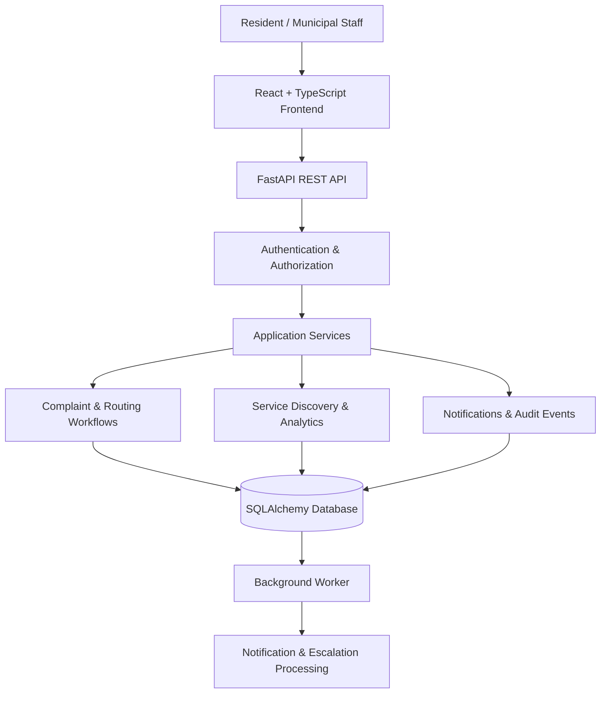

# CityPulse — Your City. Your Voice. Your Impact. 🌆

<p align="center">
  <strong>A Civic-Tech Platform for Smarter, More Accountable Cities</strong>
</p>

<p align="center">
  Report civic issues, discover municipal services, track complaint progress, and help communities build better cities through transparent digital workflows.
</p>

<p align="center">
  
  
  
  
  
</p>

---

## 📌 Overview

**CityPulse** is a civic-service management platform designed to bridge the gap between residents and municipal service teams.

Issues such as potholes, overflowing garbage, damaged streetlights, water leaks, and blocked drains can disrupt everyday life. Reporting these problems is only the first step; residents also need a way to understand where their reports go, follow their progress, and receive meaningful updates.

CityPulse provides a structured digital workflow for reporting issues, routing complaints to relevant departments, managing cases, and tracking outcomes. It combines a resident-facing experience with operational tools for officers, supervisors, and administrators.

The platform emphasizes **transparency, accountability, role-based access, and reliable case management**.

## ✨ Key Features

### 🏙️ Civic Issue Reporting
- Submit civic complaints with descriptions, categories, and supporting images.
- Track submitted reports through a structured status timeline.
- View complaint history, comments, and relevant updates.
- Support report visibility and case-management workflows.

### 🧭 Intelligent Complaint Routing
- Match reports against configurable categories, departments, wards, and routing rules.
- Use category hierarchy and rule precedence to determine routing.
- Send ambiguous or unmatched reports to a designated triage queue rather than inventing a department.
- Preview routing decisions before submitting a complaint.

### 🏢 Municipal Service Discovery
- Search for relevant municipal services.
- Discover services using names, descriptions, synonyms, and related categories.
- View service details and availability information.
- Return an explicit no-match result when a suitable service cannot be identified.

### 🔄 End-to-End Case Management
- Manage complaint assignment, review, progress, resolution, closure, and reopening.
- Maintain a history of status changes and assignments.
- Support staff comments and internal notes with appropriate access restrictions.
- Handle duplicate reports through controlled review and merging workflows.

### ⏱️ Service-Level Tracking
- Configure illustrative service-level agreement (SLA) targets.
- Identify overdue complaints and cases approaching their deadlines.
- Generate reminders and escalation events through background processing.
- Preserve case history and escalation records for accountability.

### 📊 Analytics and Reporting
- Monitor complaint volumes, open cases, resolution times, and SLA compliance.
- Analyze cases by department, category, ward, and priority.
- Export authorized analytics to CSV.
- Apply department-specific visibility to relevant operational metrics.

### 🔐 Role-Based Access Control
CityPulse supports distinct roles with different permissions:

| Role | Primary responsibility |
|---|---|
| Resident | Submit and track personal complaints |
| Field Officer | Process assigned cases and update progress |
| Supervisor | Manage departmental workflows and escalations |
| Municipal Administrator | Configure services, departments, and operational rules |
| System Administrator | Manage platform-level operations and access |
| Auditor | Review authorized records and audit information |

Permissions are enforced by the backend, not just by hiding frontend navigation items.

### 🌐 Accessible, Localized Interface
- English and Telugu interface support.
- Responsive layouts for desktop and mobile screens.
- Civic-focused visual design with glass-inspired surfaces and CSS-based 3D illustrations.
- Reduced-motion and visual fallbacks for supported interface effects.

### 🛡️ Privacy and Reliability
- Password hashing and revocable authentication sessions.
- Input validation, request-size limits, and rate limiting on relevant endpoints.
- Audit logging and structured error responses.
- Image re-encoding to remove embedded EXIF/GPS metadata.
- Authorized media access and safeguards against duplicate event delivery.

## 🧰 Technology Stack

| Layer | Technologies |
|---|---|
| Frontend | React, TypeScript, Vite |
| UI and Styling | CSS, responsive design, CSS-based 3D effects |
| Backend | Python, FastAPI, Pydantic |
| Database | SQLite for local development; PostgreSQL-compatible persistence |
| ORM and Migrations | SQLAlchemy 2, Alembic |
| Authentication | JWT-based authentication, Argon2 password hashing, revocable sessions |
| Background Processing | Python worker, transactional outbox, retry mechanisms |
| Testing | Pytest, Vitest |
| Code Quality | Ruff, Mypy, TypeScript type checking |
| API Documentation | FastAPI OpenAPI documentation |

## 🏗️ System Architecture

CityPulse uses a **modular monolith architecture**. The frontend communicates with a REST API, while the backend separates HTTP handling, business rules, database persistence, and external-service adapters.



### Architectural Principles

- **Separation of concerns:** HTTP handlers, business logic, and persistence have distinct responsibilities.
- **Backend-enforced security:** Role permissions and record visibility are checked on the server.
- **Traceable operations:** Important case changes generate history and audit records.
- **Configurable workflows:** Departments, categories, routing rules, and SLA policies are data-driven.
- **Reliable event processing:** Background jobs use persisted events and deduplication to reduce duplicate processing.

## 📂 Project Structure

```text
CityPulse/
├── app/
│   ├── api/             # REST API routers
│   ├── adapters/        # Classifier and provider integrations
│   ├── core/            # Configuration, security and permissions
│   ├── db/              # Database setup and sessions
│   ├── domain/          # Routing, workflow and SLA rules
│   ├── jobs/             # Background worker
│   ├── models/          # Database models
│   ├── schemas/         # Request and response validation
│   ├── services/        # Application business logic
│   ├── cli.py           # Operational commands
│   ├── seed.py          # Development demo data
│   └── main.py          # FastAPI application
├── alembic/             # Versioned database migrations
├── tests/               # Backend test suite
├── web/
│   ├── public/          # Static assets
│   └── src/             # React application
├── .env.example         # Example configuration
├── alembic.ini
├── pyproject.toml
├── uv.lock
└── README.md
```

## 🚀 Getting Started

### Prerequisites

Install the following before running CityPulse:

- Python 3.12 or later
- [uv](https://docs.astral.sh/uv/) for Python dependency management
- Node.js and npm for the frontend
- Git

### 1. Clone the Repository

```bash
git clone https://github.com/saisharatkaruturi/CityPulse.git
cd CityPulse
```

### 2. Set Up the Backend

Install the Python dependencies:

```bash
uv sync
```

Create your local environment configuration:

```bash
# Windows PowerShell
Copy-Item .env.example .env
```

Apply database migrations and create fictional development data:

```bash
uv run python -m app.cli migrate
uv run python -m app.cli seed
```

Start the backend:

```bash
uv run uvicorn app.main:app --reload
```

The API will be available at:

- **API:** http://127.0.0.1:8000
- **Interactive API documentation:** http://127.0.0.1:8000/docs

### 3. Set Up the Frontend

Open a second terminal:

```bash
cd web
npm install
npm run dev
```

Open the local URL printed by Vite, typically:

http://localhost:5173

The Vite development server proxies API requests to the backend. Keep the backend running while using the frontend.

### 4. Run the Background Worker

For notification delivery, reminders, escalations, and other background tasks, open another terminal in the repository root:

```bash
uv run python -m app.cli worker
```

To run a single processing pass:

```bash
uv run python -m app.cli worker --once
```

## 🧪 Testing and Code Quality

Run the backend test suite:

```bash
uv run pytest
```

Run backend linting:

```bash
uv run ruff check app tests alembic
```

Run backend type checking:

```bash
uv run mypy app
```

Run frontend unit tests:

```bash
cd web
npm test
```

Check frontend TypeScript types:

```bash
npx tsc -b
```

Build the frontend for production:

```bash
npm run build
```

## 🔑 Demo Accounts

CityPulse includes fictional demo accounts for local development. The seeded accounts use the default demo password configured by the application.

| Example account | Role |
|---|---|
| `resident1@example.com` | Resident |
| `roads.officer1@example.com` | Field Officer |
| `roads.supervisor@example.com` | Supervisor |
| `muni.admin@example.com` | Municipal Administrator |
| `admin@example.com` | System Administrator |
| `auditor@example.com` | Auditor |

**Development only:** The default demo password is `demo-password-123`, unless changed through configuration. Use demo accounts only in a local development environment. Never deploy default demo credentials to a public production environment.

The seed data uses fictional departments, wards, services, and complaints. It is intended to demonstrate application workflows, not to represent actual municipal records.

## 🔌 API Overview

CityPulse exposes REST endpoints for authentication, complaints, routing, service discovery, notifications, analytics, and administrative operations.

| Endpoint | Purpose |
|---|---|
| `/api/auth/register` | Register an account |
| `/api/auth/login` | Authenticate a user |
| `/api/auth/logout` | Revoke the active session |
| `/api/complaints` | Create, list, and filter complaints |
| `/api/complaints/{id}` | Retrieve or update an authorized complaint |
| `/api/routing/suggest` | Preview category and department routing |
| `/api/services` | Discover municipal services |
| `/api/users/me` | Access the current user's profile |
| `/api/users/me/notification-preferences` | Manage notification preferences |
| `/api/admin/analytics` | Retrieve authorized operational analytics |
| `/api/admin/outbox` | Inspect pending or failed background events |

For request schemas, response formats, and available operations, start the backend and visit `/docs`.

## 🤖 AI and External Integrations

CityPulse is designed with replaceable service adapters for classification, geocoding, media storage, notifications, and municipal integrations.

The current default classification flow uses deterministic keyword and synonym matching, with a simulated classifier available for demonstration. A real language model can be integrated through the classifier adapter.

**AI and external-service behavior is intentionally transparent:** simulated integrations should not be mistaken for live municipal connections or verified real-world outcomes. The platform can operate without an external AI provider, and uncertain classifications can be directed to triage.

## 🔒 Security and Privacy Notes

CityPulse incorporates several application-level safeguards:

- Server-side role and record-scope checks.
- Password hashing and revocable sessions.
- Validated request schemas and consistent API errors.
- Authorized complaint and media access.
- Image re-encoding to strip EXIF/GPS metadata.
- Audit records for important administrative and workflow changes.
- Event deduplication and bounded retries for background processing.

These controls do not, by themselves, constitute a full production security audit. Production deployment requires environment-specific configuration, secret management, infrastructure hardening, monitoring, backups, and review of all enabled integrations.

## 🗺️ Roadmap

Potential future improvements include:

- Integration with verified municipal service providers.
- Production-grade notification channels and delivery monitoring.
- Real geospatial boundaries and jurisdiction datasets.
- A production AI classifier with evaluation and confidence monitoring.
- Deployment automation and observability dashboards.
- Additional accessibility testing and native-language review.
- Public deployment with documented operational and privacy policies.

## 🎯 Project Goals

CityPulse explores how software engineering can improve civic-service delivery through:

- Transparent issue reporting and progress tracking.
- Structured department routing and case ownership.
- Secure, role-aware application workflows.
- Data-driven operational analytics.
- Maintainable backend architecture and automated testing.
- Accessible, multilingual user experiences.

## 🤝 Contributing

Contributions, bug reports, and suggestions are welcome.

1. Fork the repository.
2. Create a feature branch.
3. Implement your changes and add relevant tests.
4. Run the applicable test and code-quality checks.
5. Submit a pull request describing the change.

## 📄 License

No license has been specified in this repository yet. Unless a license is added, the default copyright restrictions apply; contact the repository owner before redistributing or reusing the code.

---

<p align="center">
  <strong>CityPulse — Better reporting. Clearer accountability. Smarter civic services.</strong>
</p>

<p align="center">
  Built by <a href="https://github.com/saisharatkaruturi">Sai Sharat Karuturi</a>
</p>
